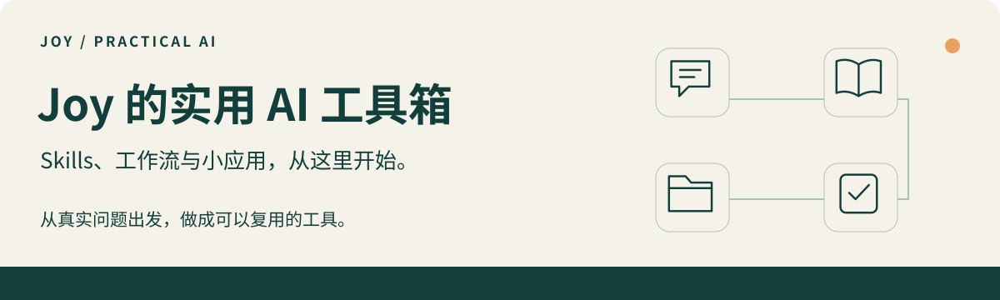

# Joy 的实用 AI 工具箱

**从业务一线探索 AI Agents，把反复打磨的方法做成可复用的 Skills、工作流与小应用。**

[按任务选工具](#按任务选工具) · [看精选作品](#精选作品) · [第一次使用](#第一次使用) · [近期更新](#近期更新) · [认识 Joy](https://github.com/JoyZhang666)

这里有 **12 个 Skill**，帮助你写文章、做研究、整理会议、阅读资料和管理日常工作。Skill 是交给 AI 助手阅读和执行的工作说明，有些附带脚本和模板；先选一个任务，再按对应指南准备。

## 按任务选工具

**找到你想做的事，点击作品名称即可进入使用说明。** ★ 为本页精选，非使用量或成熟度排名。

| 序号 | 我想做什么 | 选择哪个 Skill | 最后拿到什么 |
|:---:|---|---|---|
| 01 | 写一篇公众号文章 | ★ [微信公众号写作助手](kb-to-wechat-article/README.md) | 标题、提纲、文章草稿与待核对事项 |
| 02 | 研究公司、产品或人物 | ★ [横纵研究与商业尽调](hv-analysis-joy/README.md) | 分析报告、一页决策简报与证据清单 |
| 03 | 推进会议中的待办 | ★ [Get 会议行动](getnote-meeting-actions/README.md) | 有原文依据的行动清单与获授权执行后的成果 |
| 04 | 把视频整理成文字 | [YouTube 转写全文稿](youtube-transcript/README.md) | 按来源顺序保存的全文稿草稿与待核对标识 |
| 05 | 认真读完一本书 | [全书精读工作流](full-book-deep-reading-workflow/README.md) | 逐章笔记、阅读进度与范围明确的综述 |
| 06 | 整理 Get 知识库 | [GetNote 知识库整理](getnote-knowledge-manager/README.md) | 分类建议与获授权归档后的核验记录 |
| 07 | 制作手机阅读文档 | [适合手机阅读的 PDF 生成器](mobile-pdf-report/README.md) | 窄幅 PDF；使用前先看验证限制 |
| 08 | 整理项目文件与交接 | [项目文件管理](project-file-management/README.md) | 工作区索引、项目登记与交接记录 |
| 09 | 记录课程消耗与余额 | [课程课时台账](class-hours-ledger/README.md) | 本地课时流水、余额与一致性备份 |
| 10 | 安装、维护代理工具 | [mihomo 安装与运维](mihomo-vpn-install/README.md) | 配置、检查、排障与回滚指引 |
| 11 | 用 VPS 配置客户端连接 | [Crossborder Tunnel Kit](crossborder-tunnel-kit/README.md) | Mihomo 客户端 YAML 与导入、排障指引 |
| 12 | 批量整理文件与文件夹名称 | [批量命名整理](batch-name-curation/README.md) | 完整改名清单、获批执行后的核验结果与回滚入口 |

**选用提示：** Get 相关工具需要对应账号授权；两项网络工具需要 Linux 与网络基础，Tunnel Kit 还需要 VPS。手机 PDF 工具的真实隔离渲染尚未验收。各作品的依赖、验证范围与限制以其使用说明为准。

## 精选作品

从三个具体任务开始，了解这些 Skill 如何把资料变成可继续使用的成果。

### 01｜微信公众号写作助手

**把笔记、资料和想法，整理成一篇有依据、方便修改的文章。**

- **你提供：** 一个主题或一份资料，再说说写给谁看。
- **你得到：** 标题建议、提纲、文章草稿，以及需要核对的事实和来源。
- **特色：** 一步步带新手完成首篇；知识库可跳过，基础写作无需公众号密钥。满意后再按需配图、排版或送草稿箱。

> 试着说：“我第一次用，没有知识库。请根据我的三条心得写一篇短文，先给标题和提纲。”

**开始使用 → [公众号写作新手指南](kb-to-wechat-article/references/getting-started.md)**  
其他资料：[功能与准备条件](kb-to-wechat-article/README.md) · [版本记录](kb-to-wechat-article/CHANGELOG.md)

送草稿箱需配置接口并获授权，公开发表由你完成；Word 转换的支持范围见项目说明。

---

### 02｜横纵研究与商业尽调

**从“这家公司是什么情况”，走到“是否值得接触、还缺什么证据”。**

- **你提供：** 公司、产品或人物，以及你希望解决的决策问题。
- **你得到：** 有来源定位的分析、一页决策简报、证据与待核验清单。
- **特色：** 先核实主体，再看发展历程与同期竞争；区分合作吸引力和证据充分度。基础研究无需专用 API Key 或知识库账号。

> 先看成果：[虚构供应商的一页决策简报](hv-analysis-joy/examples/synthetic-supplier/decision-brief.md)。示例用于了解交付形式，不代表真实公司结论。

**开始使用 → [研究安装与工具指南](hv-analysis-joy/references/setup.md)**  
其他资料：[功能与准备条件](hv-analysis-joy/README.md) · [验证范围](hv-analysis-joy/VALIDATION.md)

Joy 改编版，基于 KKKKhazix 的横纵分析方法；真实研究仍需核对来源和事实。

---

### 03｜Get 会议行动

**把会议原文变成有依据的待办，再按你选定的事项推进。**

- **你提供：** 指定的 Get 会议原文与处理范围。
- **你得到：** 带稳定编号的行动清单；获授权执行后保存本地成果与续接记录。
- **特色：** 每项待办能回到原文；可以按编号选择执行，并接着上次进度继续。

> 试着说：“先列出有原文依据的待办。”确认清单后，再说：“1、3 你来做。”

**开始使用 → [会议行动使用指南](getnote-meeting-actions/README.md#开始使用)**  
其他资料：[完整技能流程](getnote-meeting-actions/SKILL.md) · [来源与改编说明](getnote-meeting-actions/references/upstream.md)

需要 Get 官方 CLI 授权；成果默认本地保存，上传 Get 需另行授权。

## 第一次使用

1. **选一个任务：** 从[上方目录](#按任务选工具)进入对应作品。
2. **让 AI 带你准备：** 阅读该作品的 README 和 SKILL，确认输入、依赖与权限，再安装或加载完整目录。
3. **先做一个小样本：** 使用虚构或有权处理的资料，核对成果后再扩大范围。

**[打开完整新手指南 →](docs/start-here.md)**  
无需安装 GitHub Windows 客户端。是否能自动安装、读取文件或运行脚本，取决于你使用的 AI 助手。

## 近期更新

- **2026-10-26 · 批量命名整理 v1.1.0：** 新增文件与目录命名整理，先审批清单再执行，提供完整性核验与回滚。[开始使用](batch-name-curation/README.md)
- **2026-10-19 · 横纵研究 v1.0.2：** 统一公开名称为 `hv-analysis-joy`。[查看说明](hv-analysis-joy/README.md#从旧版升级)
- **2026-10-08 · 公众号写作 v4.16.0：** 增加手机版 Word 副本与 PDF 页图可读性检查。[查看变化](kb-to-wechat-article/CHANGELOG.md)

## 实践手记

- [返回了文字，为什么还不能算“全文交付”？](docs/notes/transcript-completeness.md)
- [一个 Skill 公开前，如何检查隐私与来源？](docs/notes/publish-with-care.md)
- [怎样让第一次配置 API 的人走完最后一步？](docs/notes/first-api.md)

## 维护方式

各作品的版本、依赖、测试范围和限制以目录内 README、SKILL 与变更记录为准。反馈问题时请使用虚构或脱敏示例：[提交 Issue](https://github.com/JoyZhang666/joy-agent-skills/issues)。

## 来源与许可

Get 会议行动基于 [Zara（zarazhangrui）的 lark-minutes-tasks](https://github.com/zarazhangrui/lark-minutes-tasks) 改编。改编范围及参考版本见[来源记录](getnote-meeting-actions/references/upstream.md)，原始 MIT 版权及许可全文保留于该 Skill 的 [LICENSE](getnote-meeting-actions/LICENSE)。横纵研究与商业尽调基于 [KKKKhazix 的 hv-analysis](https://github.com/KKKKhazix/khazix-skills/tree/main/hv-analysis) 改编，改造范围、参考提交及许可见[来源说明](hv-analysis-joy/THIRD-PARTY-NOTICES.md)。各作品以所在目录的许可证为准。

## 隐私

本仓库仅收录通用说明、脚本、空白模板和虚构示例。真实会议、个人配置、客户资料、登录凭据和运行日志不纳入仓库。上传前逐项检查文件；网页上传也需要人工检查，不能依赖 .gitignore 自动阻止敏感文件上传。

